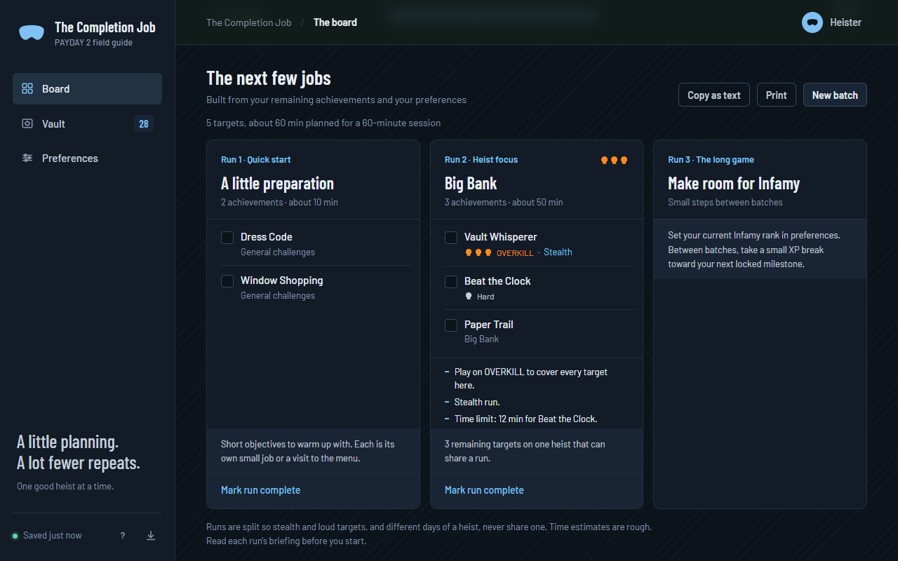

# The Completion Job

A planning board for the PAYDAY 2 achievements you have not unlocked yet. Import your list, and it groups what is left by heist, builds sessions that fit the time you have, and keeps track as you tick things off. Everything stays in your browser; there is no account to create and nothing to install.



## What it does

The site opens on a start screen that asks for your achievements file. Once that is in, there are three views.

The board shows how far along you are, where the remaining work is (achievements per heist), and a plan for your next session. Each run in the plan comes with a short briefing: which difficulty covers every target in it, whether it is a stealth or loud run, which day of a multi-day heist, any time limits, and any loadout conditions. You can swap a target you do not feel like doing, mark a whole run complete, copy the plan as text, or print it.

The vault lists every remaining achievement with its original Steam description. You can search, filter by heist, type, status, or difficulty, sort by rarity, and group by heist. Each achievement has a notes field, a "set aside for later" option, and links to the PAYDAY wiki and Steam guides.

Preferences hold your name, Steam ID, Infamy rank, playstyle, comfortable difficulty, session length, batch size, DLC, and mods. Session length and batch size decide how much goes into a plan.

Difficulty is shown with skulls, the same way the game does it.

## How the planner works

It reads the achievement descriptions. From each one it pulls the heist name, the difficulty and whether it says "or above", stealth or loud wording, the day number, time limits, loadout restrictions such as "using only" or "without using", and crew wording. Each target also gets a rough time estimate from its type and conditions.

Targets on the same heist are grouped, then split so a stealth target never shares a run with a loud one and different days stay separate. Targets that share a run only add a few minutes each, so clusters are cheap and the planner favours them. Runs are added until your session length or batch size is used up. With variety on, a session opens with a couple of quick objectives, puts the biggest heist cluster next, adds at most one hard challenge, then fills with other heists. Infamy breaks go at the end.

What it cannot tell you: whether two targets on the same heist can be earned in the same run, whether a solo mod covers a crew achievement, or how long a run will take you. Treat the briefing as a checklist. The "How the planner works" button on the board says the same thing in the app.

## Getting your achievements file

The site needs a JSON file of your achievements. The straightforward way to get one is the Steam Web API, which any Steam account can use:

1. Create a key at https://steamcommunity.com/dev/apikey. The domain name field is not checked; put anything.
2. Find your SteamID64, the 17-digit number in your profile URL or under Edit Profile. Your game details must be public.
3. Open this address in your browser with your key and ID filled in, and save the page as a `.json` file:

   ```text
   https://api.steampowered.com/ISteamUserStats/GetPlayerAchievements/v1/?appid=218620&l=english&key=YOUR_KEY&steamid=YOUR_ID
   ```

4. Import that file on the start screen.

`l=english` matters. Without it Steam returns only internal identifiers, and the planner has nothing to read. Hidden achievements come back with an empty description even with the language set; those import fine and are filed under General challenges.

Keep the key to yourself. The site never asks for it and has nowhere to store it. You can delete it afterwards from the same Steam page.

The start screen walks through the same steps, and a name and Steam ID can be entered there too. Both are optional. The Steam ID is only used to link to your achievements page; nothing is fetched automatically.

### Building the file by hand

Any JSON with an `achievements` array works. Each entry needs a name and a status. The description is what the planner reads, so include it where you have it:

```json
{
  "counts": { "total": 1342, "unlocked": 1094, "locked": 248 },
  "achievements": [
    { "name": "Achievement name", "description": "Full requirement text", "status": "locked" }
  ]
}
```

`counts` is optional. If present, the number of locked records in the file must match `counts.locked`, and `total` must equal `unlocked` plus `locked`. This catches partial exports: a saved copy of the Steam achievements web page only contains the rows that were on screen, and the importer rejects `.html` files for that reason.

## Your data

Checkmarks, notes, plans, and preferences are written to browser storage every time they change. The sidebar shows when the last save happened.

Browser storage can be cleared by the browser, so export a backup once you have progress worth keeping. Preferences shows when you last did. A backup is a single JSON file with your achievement list and everything you have recorded; it can be imported on the start screen or from the vault. Importing a backup replaces what is in the browser.

Preferences also has a button to remove everything from the browser and go back to the start screen.

Checking something off here does not change anything on Steam.

## Shortcuts and install

`1`, `2`, `3` switch views, `/` searches, `g` builds a new batch, `b` downloads a backup, `?` shows the full list.

You can install it as an app from the browser menu or from Preferences. It works offline once installed.

## Running it locally

Node.js 20 or later. No packages to install.

```text
npm start
```

Open http://127.0.0.1:4173. `npm test` runs the planner and import tests against a small synthetic fixture in `tests/fixtures/`.

## Hosting on GitHub Pages

A workflow in `.github/workflows/pages.yml` deploys the site on every push to `main`. It runs the tests first, copies only the files the browser needs into a staging folder, stamps the service worker's cache name with the commit hash so visitors pick up the new version, and publishes with the official Pages actions.

To turn it on: Settings → Pages → Build and deployment → Source → **GitHub Actions**. The first push to `main` after that deploys the site; the workflow can also be run by hand from the Actions tab.

Asset paths are relative, so the site works under a project path like `/the-completion-job/`. If you fork it, change the `og:url` and `og:image` tags in `index.html` to your own Pages address.

The `CACHE` name in `sw.js` only matters for local previews; the workflow replaces it on deploy.

## Project layout

| File | What it is |
| --- | --- |
| `index.html` | The page: start screen, views, forms, dialogs |
| `styles.css` | Styles, including the print layout for the session plan |
| `app.js` | UI, storage, import/export, shortcuts, service worker registration |
| `planner.js` | Dataset validation, classification, condition parsing, session planning |
| `sw.js`, `manifest.webmanifest`, `icons/` | Offline support and install metadata |
| `scripts/serve.mjs` | Local preview server |
| `.github/workflows/pages.yml` | Tests and deploys to GitHub Pages on push to `main` |
| `tests/` | Tests and the synthetic fixture they run against |

## Limits

- The planner only has the description text to go on. Whether two achievements on one heist can be earned together is still your call.
- Crew wording is flagged so you can check it. The planner does not know whether a solo mod covers that achievement.
- Time estimates are rough and the same for everyone.
- There is no Steam sync. Progress on the site and progress on Steam are separate.

Independent fan project. PAYDAY and related marks belong to their owners.
